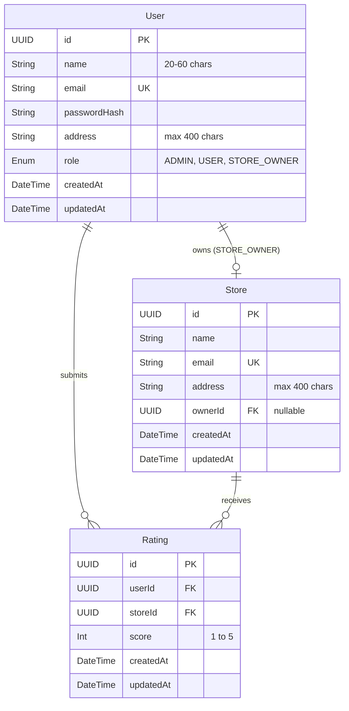

# Product Requirements Document (PRD)
## Project: Store Rating Platform (Full-Stack Coding Challenge)

---

## 1. Executive Summary & Objective

The **Store Rating Platform** is a multi-tenant, role-based web application allowing users to discover registered stores and submit ratings (1 to 5 stars). The platform provides tailored interfaces for three distinct stakeholder personas: **System Administrators**, **Store Owners**, and **Normal Users**, unified behind a single authentication gateway.

### Core Objectives:
- Provide an intuitive rating and discovery platform for stores.
- Guarantee strict input validation compliance (e.g., Name 20–60 chars, Password complexity, Address length).
- Deliver high-performance list views with real-time filtering, searching, and column-level sorting.
- Maintain clean separation of concerns, robust RBAC (Role-Based Access Control), and relational data integrity.

---

## 2. Tech Stack Selection

| Component | Selected Technology | Rationale |
| :--- | :--- | :--- |
| **Backend** | **Express.js with TypeScript** | Lightweight, industry-standard, fast setup, clean routing, strong typing with Zod / DTOs. |
| **Database** | **PostgreSQL** (via **Prisma ORM**) | ACID-compliant relational DB; ensures unique user ratings per store, fast aggregations, declarative schema, and automated migrations. |
| **Frontend** | **React.js (Vite + TypeScript)** | Fast HMR, reactive state management, modular component architecture. |
| **Styling & UI**| **TailwindCSS + Lucide Icons** | Modern aesthetic, responsive design, sleek cards, accessible modals and tables. |
| **Auth** | **JWT (JSON Web Tokens) + bcrypt** | Stateless authentication with Bearer tokens & role-based route guard middleware. |

---

## 3. User Roles & Permission Matrix

| Feature / Action | System Administrator | Normal User | Store Owner | Public / Guest |
| :--- | :---: | :---: | :---: | :---: |
| **User Registration** | ❌ (Internal create) | ✅ (Self sign-up) | ❌ (Created by Admin) | ✅ (Sign up) |
| **Unified Login** | ✅ | ✅ | ✅ | ❌ |
| **Change Password** | ❌ (Direct admin reset) | ✅ | ✅ | ❌ |
| **Global Metrics Dashboard** | ✅ | ❌ | ❌ | ❌ |
| **Add New Store** | ✅ | ❌ | ❌ | ❌ |
| **Add New Admin / User / Owner** | ✅ | ❌ | ❌ | ❌ |
| **View All Users + Roles** | ✅ (Full view + filter) | ❌ | ❌ | ❌ |
| **View Store Owner Rating** | ✅ | ❌ | ❌ | ❌ |
| **View All Stores** | ✅ | ✅ | ❌ (Own store only) | ❌ |
| **Search Stores (Name/Address)**| ✅ | ✅ | ❌ | ❌ |
| **Submit / Modify Rating (1-5)**| ❌ | ✅ | ❌ | ❌ |
| **View Store Ratings & Reviewers**| ✅ | ❌ | ✅ (Own store only) | ❌ |
| **View Store Average Rating** | ✅ | ✅ | ✅ | ❌ |

---

## 4. Detailed Functional Specifications

### 4.1 Authentication & Authorization
- **Single Entry Point**: Common login screen for all roles (`/login`).
- **Role Redirection**:
  - Admin $\rightarrow$ `/admin/dashboard`
  - Normal User $\rightarrow$ `/stores`
  - Store Owner $\rightarrow$ `/owner/dashboard`
- **Session Handling**: JWT access tokens stored securely; token payload contains `{ id, email, role, storeId? }`.
- **Change Password**: Dedicated modal/page allowing authenticated users to change their password by supplying the old password and confirming the new password against validation rules.

### 4.2 System Administrator Module
1. **Analytics Overview**:
   - Total number of registered users (broken down by role).
   - Total registered stores.
   - Total submitted ratings.
2. **Store Management**:
   - Create Store Modal: Store Name, Email, Address, Assign Store Owner (or create unassigned).
   - Stores Table: Columns: `Name`, `Email`, `Address`, `Overall Rating (Average)`, `Action`.
   - Sorting: Ascending/Descending on Name, Email, Address, Overall Rating.
   - Filtering: Live search query matching Name, Email, Address.
3. **User Management**:
   - Create User Modal: Name, Email, Password, Address, Role selector (`ADMIN`, `USER`, `STORE_OWNER`).
   - Users Table: Columns: `Name`, `Email`, `Address`, `Role`, `Associated Rating` (visible for Store Owners).
   - Sorting: Ascending/Descending on Name, Email, Address, Role.
   - Filtering: Multi-field filters on Name, Email, Address, Role.

### 4.3 Normal User Module
1. **Public Signup**:
   - Form fields: Name, Email, Address, Password.
   - Strict real-time client-side + server-side validation.
2. **Stores Directory**:
   - Grid and tabular views of stores.
   - Search bar: Real-time search by Store Name or Store Address.
   - Store Card / Row details:
     - Store Name
     - Address
     - Overall Community Rating (1.0 to 5.0 with star representation)
     - User's Submitted Rating (displaying current user's rating if already submitted, or "Not Rated")
     - "Submit Rating" / "Modify Rating" button.
3. **Rating Submission & Modification**:
   - Interactive star rating component (1 to 5 integer scale).
   - Upsert logic: If user hasn't rated, inserts new record; if already rated, updates the existing rating.
   - Live recalculation of the store's average rating.

### 4.4 Store Owner Module
1. **Store Performance Dashboard**:
   - Prominent display of the Store's Overall Average Rating (e.g., `4.6 / 5.0 ★`).
   - Total number of reviews received.
2. **Customer Feedback Table**:
   - Table displaying all users who submitted ratings for this store.
   - Columns: `Customer Name`, `Customer Email`, `Customer Address`, `Rating Given`, `Submitted At`.
   - Sorting by Customer Name, Rating, Date.

---

## 5. Form Validation & Data Integrity Rules

All validations must be strictly enforced on both **Frontend** (instant feedback) and **Backend** (API payload validation via Zod).

| Field | Rule | Regex / Criteria | Error Message |
| :--- | :--- | :--- | :--- |
| **Name** | Min 20, Max 60 chars | `^.{20,60}$` | "Name must be between 20 and 60 characters." |
| **Address** | Max 400 chars | `^[\s\S]{1,400}$` | "Address cannot exceed 400 characters." |
| **Password** | 8–16 chars, $\ge 1$ Uppercase, $\ge 1$ Special Char | `^(?=.*[A-Z])(?=.*[!@#$%^&*()_+\-=\[\]{};':"\\|,.<>\/?]).{8,16}$` | "Password must be 8-16 characters and contain at least one uppercase letter and one special character." |
| **Email** | Standard RFC 5322 Email Format | Standard email regex, lowercased, unique | "Please provide a valid email address." |
| **Rating** | Integer between 1 and 5 | `value >= 1 && value <= 5` | "Rating must be between 1 and 5." |

---

## 6. Database Schema Design (PostgreSQL / Prisma)

### Unique Constraints & Indexing:
1. `User.email` $\rightarrow$ `UNIQUE INDEX`
2. `Store.email` $\rightarrow$ `UNIQUE INDEX`
3. `Rating(userId, storeId)` $\rightarrow$ `UNIQUE CONSTRAINT` (guarantees 1 rating per user per store).
4. `Rating.storeId` $\rightarrow$ `INDEX` (for rapid average rating calculations).

---

## 7. RESTful API Architecture

### 7.1 Authentication Endpoints
- `POST /api/auth/register` - Normal user signup
- `POST /api/auth/login` - Single login returning JWT token & user profile
- `GET /api/auth/me` - Retrieve current session details
- `PATCH /api/auth/change-password` - Update password (requires old + new password)

### 7.2 Admin Endpoints (`requireAuth`, `requireRole('ADMIN')`)
- `GET /api/admin/metrics` - Total counts of users, stores, ratings
- `GET /api/admin/users?search=&role=&sortBy=&order=&page=&limit=` - List users with filters and sorting
- `POST /api/admin/users` - Create any user role (Admin, Normal, Store Owner)
- `GET /api/admin/stores?search=&sortBy=&order=&page=&limit=` - List stores with overall rating
- `POST /api/admin/stores` - Create new store & assign store owner

### 7.3 Store Endpoints (`requireAuth`)
- `GET /api/stores?search=&sortBy=&order=` - List stores with overall rating and current user's rating
- `GET /api/stores/:id` - Detailed store info

### 7.4 Rating Endpoints (`requireAuth`, `requireRole('USER')`)
- `POST /api/ratings` - Submit or modify a rating for a store (`{ storeId, score }`)
- `GET /api/ratings/my-ratings` - Fetch all ratings submitted by logged-in user

### 7.5 Store Owner Endpoints (`requireAuth`, `requireRole('STORE_OWNER')`)
- `GET /api/owner/dashboard` - Get store average rating & breakdown
- `GET /api/owner/reviewers?sortBy=&order=` - List of users who rated their store

---

## 8. Non-Functional Requirements & Best Practices

1. **Security**:
   - Passwords hashed with `bcrypt` (salt rounds: 10–12).
   - JWT signed with secure secret key and expiration.
   - CORS policy configured; helmet HTTP security headers enabled.
   - SQL injection prevented via parameterized Prisma queries.
2. **User Experience & Design**:
   - Modern, aesthetic UI with rich palettes, smooth transitions, and glassmorphic / card elevations.
   - Mobile-responsive layout (collapsible sidebar / mobile navigation).
   - Visual star rating widget with hover states.
   - Clear validation feedback on forms before submission.
3. **Database Efficiency**:
   - Aggregated average ratings calculated via SQL `AVG()` queries.
   - Debounced search queries on tables to avoid excessive API requests.

---

## 9. Phased Implementation Plan

- [ ] **Phase 1: Project Setup & Database Layer**
  - Initialize clean client/server monorepo structure.
  - Setup Express + TypeScript, Prisma ORM, and PostgreSQL.
  - Define schema, migrations, and database seed script (Admin, sample stores, users).
- [ ] **Phase 2: Authentication & RBAC Core**
  - Implement Zod schema validation for all inputs.
  - Implement register, login, change-password, and JWT middleware.
- [ ] **Phase 3: Backend API Endpoints**
  - Implement Admin endpoints (Metrics, User management, Store management).
  - Implement Stores & Ratings endpoints with upsert logic.
  - Implement Store Owner endpoints with reviewer list.
- [ ] **Phase 4: Frontend Application (React + Vite)**
  - Setup UI design system, color palette, and routing.
  - Auth pages: Login, Signup, Change Password modal.
  - Admin dashboard: Metric cards, users table, stores table with dynamic sort/filter.
  - Normal User dashboard: Store list, search, interactive rating modal.
  - Store Owner dashboard: Average rating badge, customer rating logs.
- [ ] **Phase 5: Testing, Validation & Polish**
  - Verify all validation rules (20-60 character name test, password regex check).
  - Test sorting and multi-field filtering.
  - Responsive design check & end-to-end verification.
